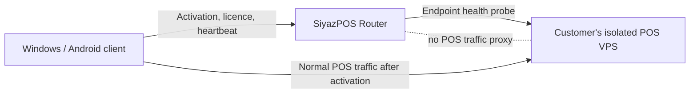

# SiyazPOS Router Architecture

## Purpose and boundary

SiyazPOS Router is the central control-plane service for separately hosted SiyazPOS installations. Every customer owns an isolated VPS account, database, SiyazPOS deployment, and endpoint. Router handles provisioning and coordination; client applications connect directly to their customer's POS endpoint after activation.

Router must never proxy normal POS requests. It must not store products, inventory, sales, receipts, cashier PINs, customer transaction histories, or other POS operational data. Its database contains only the directory and control metadata needed to identify a customer installation, provision devices, manage licences, and audit Router administration.

## Responsibilities

- **Customer and location directory:** customer account, stores/locations, store codes, and each store's registered POS endpoint.
- **Activation:** short-lived, single-use activation codes bound to a customer/store and protected against guessing and replay.
- **Device registry:** provisioned Windows/Android device identity, registration state, supported app version, last heartbeat, and limited remote configuration.
- **Licensing:** subscription state and signed, expiring licence/provisioning tokens. Signing private keys stay on the Router server and out of Git; clients receive only the verification key needed to validate tokens.
- **Endpoint health:** scheduled checks against registered customer health endpoints. Checks are outbound monitoring calls and never relay POS traffic.
- **Administration and audit:** system administration, authorization, and security-relevant audit events without logging activation secrets, signing material, or POS transaction contents.

## Request flow

1. The client contacts Router only for activation, provisioning, licence/config refresh, and device heartbeat operations.
2. Router validates the activation code and resolves the registered customer/store endpoint.
3. Router returns a signed, short-lived provisioning result containing the allowed endpoint and required client configuration.
4. The client validates and stores its assigned endpoint, then connects directly to the customer's POS server for all POS use.
5. The client contacts Router again only for the defined control-plane operations. Sales, stock, receipts, and other POS traffic remain between the client and its customer's server.

## Laravel project organization

- `routes/web.php` and Blade views are for Router's human-operated administration pages.
- `routes/api.php` is mounted separately and versioned under `/api/v1` for device/control-plane APIs.
- HTTP controllers remain thin; request validation belongs in Form Requests and authorization in policies/middleware.
- Domain workflows belong in focused application services under `app/Services`, grouped by responsibility (activation, devices, licensing, provisioning, endpoint health, and customer/store directory) as they are implemented.
- Eloquent models and migrations represent Router metadata only. No model or table mirrors POS inventory, sale, receipt, or cashier data.
- Background health checks and expiry work should use Laravel's scheduler/queue when those jobs are implemented; they must not become a traffic proxy.
- PHPUnit is the current test convention, following Laravel's starter project.

## Security and operational constraints

- Require HTTPS for registered POS endpoints and client-to-Router communication in production.
- Store activation codes as hashes; make them single-use, short-lived, rate-limited, and scoped to the intended store/device flow.
- Sign provisioning/licence tokens with an asymmetric key. Store private signing keys outside the repository in deployment secrets; include audience, expiry, and token identifiers, and support key rotation.
- Treat endpoint health checks as an SSRF boundary: only probe previously registered and verified customer endpoints, restrict schemes/ports, and defend against DNS rebinding and private/reserved address targets unless explicitly allowed for managed infrastructure.
- Apply least-privilege authorization to system administration and device actions. Audit changes to endpoints, licences, activations, and device state.
- Keep heartbeat and audit payloads minimal. Never include POS credentials, cashier PINs, transaction data, or signing secrets in logs.
- Separate Router database credentials and backups from every customer POS database and VPS.

## Current implementation status

The repository includes Laravel 12 foundations, default framework health route, versioned API route mount, and Blade/Tailwind starter view. Core metadata tables and Eloquent models now cover customers, stores, devices, hashed activation codes and device credentials, customer licences, endpoint health checks, audit logs, and system settings. The default Laravel `User` is the Router administrator identity. Reusable Form Requests provide initial validation for customer, store, activation-code, and device-registration inputs.

No activation, licensing, device provisioning, endpoint-monitoring, audit-writing workflows, or administration UI has been implemented. Device activation secrets and credentials are represented only by hashes; logs redact sensitive metadata keys. Store and customer deletion is restricted while dependent operational history exists, while deleting a device cascades to its credentials.
