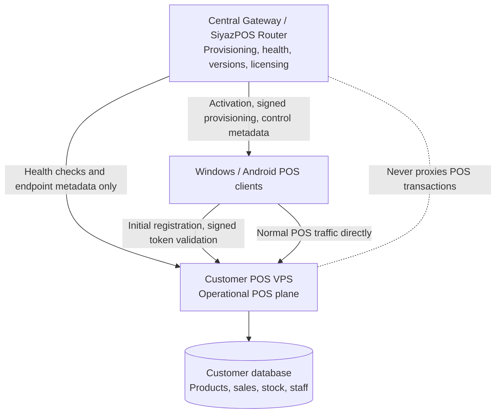

# SiyazPOS Router Architecture

## Purpose and boundary

SiyazPOS Router (Client Gateway) is the central provisioning and control plane for separately hosted SiyazPOS installations. Every customer owns an isolated VPS account, database, SiyazPOS deployment, and endpoint. The customer's VPS is the operational POS plane and owns all business data. Windows and Android clients use the Gateway for initial provisioning, then connect directly to their assigned customer POS endpoint.

Router must never proxy normal POS requests. It must not store products, inventory, sales, receipts, cashier PINs, customer transaction histories, or other POS operational data. Its database contains only directory and control metadata needed to identify customer installations, provision devices, manage licences, and audit Router administration. A Gateway outage must not immediately stop already-provisioned shops with a valid locally cached licence from trading.

## Responsibilities

- **Customer and location directory:** customer account, stores/locations, store codes, and each store's registered POS endpoint.
- **Activation:** short-lived, single-use or limited-use activation codes bound to a store, stored as password hashes, rate-limited on redemption, and protected against replay.
- **Device registry:** provisioned Windows/Android device identity, registration state, supported app version, last heartbeat, and limited remote configuration.
- **Licensing:** subscription state and signed, expiring licence/provisioning tokens. Signing private keys stay on the Router server and out of Git; clients receive only the verification key needed to validate tokens.
- **Endpoint health:** manually requested checks against each registered customer endpoint at `/api/router/health`. Automated checks are not scheduled yet; checks are outbound monitoring calls and never relay POS traffic.
- **Administration and audit:** system administration, authorization, and security-relevant audit events without logging activation secrets, signing material, or POS transaction contents.

## Request flow

1. The client generates or reads its stable Device ID. The user enters the Store Code and Activation Code.
2. The client sends activation details and safe device metadata to the Gateway.
3. The Gateway validates the customer and store state, activation expiry/revocation/usage, and applicable device/licence limits.
4. The Gateway returns the customer endpoint and a short-lived signed provisioning token.
5. The client contacts the customer POS directly; the customer POS validates the token and registers the device.
6. The client securely stores its assigned endpoint and device configuration. Future launches go directly to the customer POS.
7. The client contacts the Gateway periodically only for defined heartbeat, configuration, version, health, and licence information.
8. The customer POS verifies and caches signed licence documents locally. Sales, stock, receipts, and other operational traffic remain between the client and customer POS.

## Laravel project organization

- `routes/web.php` and Blade views are for Router's human-operated administration pages.
- `routes/api.php` is mounted separately and versioned under `/api/v1` for device/control-plane APIs.
- HTTP controllers remain thin; request validation belongs in Form Requests and authorization in policies/middleware.
- Domain workflows belong in focused application services under `app/Services`, grouped by responsibility (activation, devices, licensing, provisioning, endpoint health, and customer/store directory) as they are implemented.
- Eloquent models and migrations represent Router metadata only. No model or table mirrors POS inventory, sale, receipt, or cashier data.
- Background health checks and expiry work should use Laravel's scheduler/queue when those jobs are implemented; they must not become a traffic proxy.
- PHPUnit is the current test convention, following Laravel's starter project.

## Security and operational constraints

- Require HTTPS for registered POS endpoints and client-to-Router communication in production.
- Store activation codes as hashes; make them short-lived, rate-limited, bounded-use, and scoped to the intended store/device flow.
- Sign provisioning/licence tokens with an asymmetric key. Store private signing keys outside the repository in deployment secrets; include audience, expiry, and token identifiers, and support key rotation.
- Treat endpoint health checks as an SSRF boundary: only probe previously registered and verified customer endpoints, restrict schemes/ports, and defend against DNS rebinding and private/reserved address targets unless explicitly allowed for managed infrastructure.
- Activation codes are eight random digits displayed as `####-####`, hashed at rest, shown only on the no-store generation response, and displayed historically as a masked suffix. `POST /api/v1/activate` is rate-limited and atomically validates the code, checks device/licence/endpoint constraints, registers the Router Device, and returns the customer routing details with a five-minute signed provisioning token.
- Store endpoint input rejects credentials, query strings, fragments, IP literals, local/reserved hostnames, and non-standard ports; production requires HTTPS on port 443. The manual connection check resolves all addresses, rejects private/reserved answers, pins the resolved addresses for the request, verifies TLS, and does not follow redirects.
- Health responses are limited to 16 KB and must be HTTP 200 JSON with `status: "ok"`. Only safe `pos_version` and `api_version` values are retained. Connection errors are stored as safe classifications and never shown from raw networking exceptions.
- Apply least-privilege authorization to system administration and device actions. Audit changes to endpoints, licences, activations, and device state.
- Keep heartbeat and audit payloads minimal. Never include POS credentials, cashier PINs, transaction data, or signing secrets in logs.
- Separate Router database credentials and backups from every customer POS database and VPS.

## Current implementation status

The repository includes Laravel 12 foundations, default framework health route, versioned API route mount, and Blade/Tailwind admin UI. Core metadata tables and Eloquent models cover customers, stores, devices, hashed activation codes and device credentials, customer licences, endpoint health checks, audit logs, and system settings. The default Laravel `User` is the Router administrator identity, with active/disabled status and `super_admin`, `support`, and `read_only` roles. Session login, logout, active-account middleware, login rate limiting, authorization, dashboard, customer/store administration, and manual endpoint health checks with a System Health page are implemented. Reusable Form Requests provide validation for customer and store management.

Activation-code generation, redemption, usage limits, revocation, and audit are implemented. `POST /api/v1/activate` checks the customer, store, licence, and device limits, atomically registers the device and consumes the code, then issues a five-minute RS256 provisioning token. Token verification rules and key rotation are documented in [`DEVICE-PROVISIONING.md`](DEVICE-PROVISIONING.md). Device credentials, heartbeat/config APIs, and automated endpoint monitoring remain future work. Device activation secrets and credentials are represented only by hashes; logs redact sensitive metadata keys. Store and customer deletion is restricted while dependent operational history exists, while deleting a device cascades to its credentials. Create the initial super administrator explicitly with `php artisan router:admin:create`; no default admin credentials are seeded.
